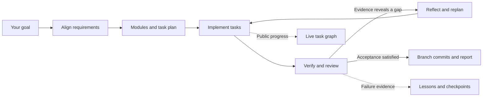

# dev-workflow

[简体中文](README.zh-CN.md) · [Installation](#get-started) · [Documentation](#documentation) · [License](#license)

A portable development workflow for **Codex and Claude Code**. Install one Skill, describe your goal, and let the agent align requirements, plan concrete tasks, implement, verify, and continue from the results.

The Skill includes eight task-specific modules and an optional Python controller for resumable work, coordinated Git branches, and a live dependency graph. **Version: 2.15.0 — developer preview.**

## What it does

- Starts with `grill-me`: resolves decisions that affect delivery before starting a new goal.
- Breaks a goal into modules, concrete tasks, dependencies, and acceptance checks; writes an execution plan.
- Routes frontend, backend, requirements, and testing work to bundled guides as needed.
- Tracks public progress in a dynamic graph with task details, attempts, events, and managed logs.
- Supports a coordinator and communicating workers in separate Git worktrees, with dependency handling and independent review in full mode.
- Optional [feature PR delivery](dev-workflow/references/feature-prs.md): test/review child PRs, merge each into one dedicated work branch, regress the actual remote merge, and revert/repair failed increments under the original budget. The parent PR stays draft. GitHub first; serial feature acceptance.
- Records checkpoints, failure evidence, and candidate lessons. Only supported lessons become verified reusable knowledge.
- Can run through an independent controller and an event-driven service, including waiting for a real human answer and resuming from it.



This diagram describes the workflow. The dashboard draws the actual tasks and dependencies from each project's current plan; it is not a fixed set of frontend/backend nodes.

## Get started

You need a coding agent with file and command tools. **Python 3.10+** powers the installer and optional progress/controller tools. Independent execution also needs Git, your project's tools, and an installed and authenticated Codex or Claude Code CLI. Node.js is needed for dashboard tests and some optional bundled module tools.

```sh
git clone https://github.com/yoyuq/dev-workflow.git
cd dev-workflow
python dev-workflow/scripts/workflow_portable.py doctor
```

Install for the agent you use, or run both commands:

```sh
python dev-workflow/scripts/workflow_portable.py install --harness codex --user
python dev-workflow/scripts/workflow_portable.py install --harness claude --user
```

New user installs go to `~/.agents/skills/dev-workflow` for Codex and `~/.claude/skills/dev-workflow` for Claude Code. Installation refuses to overwrite a different existing version. If you have a legacy Codex installation in `~/.codex/skills`, ask your agent to back it up and upgrade that installation explicitly, instead of creating a duplicate.

Then tell your agent:

> Use dev-workflow to implement this goal. First align requirements with me, then break the work into modules and tasks, write the execution plan, show the progress graph, and continue until the agreed acceptance checks are satisfied.

In Codex you can explicitly invoke `$dev-workflow`; in Claude Code use `/dev-workflow`. See the [bundled quick start](dev-workflow/README.md) for project installs and an AI-assisted installation prompt.

## Start small; use the controller when needed

**Current conversation:** the agent works in your existing session and records public progress for the local read-only viewer. It does not start extra model processes just to display the graph. The graph updates when the agent records progress; it does not monitor private reasoning or editor activity.

**Independent execution:** setup prepares configuration; the agent still needs to align requirements and prepare the actual plan and checks. `quick` supports a single task. `full` supports coordinated tasks and requires an independent reviewer.

```sh
python dev-workflow/scripts/workflow.py setup --project ../my-project --harness codex
python dev-workflow/scripts/workflow.py doctor --project ../my-project --runtime ../.workflow-my-project/runtime.json
```

For Claude Code use `--harness claude`; for coordinated work add `--mode full` to setup. `doctor` is offline by default. Add `--live --output ../workflow-probe` only when you want to make real model calls and verify CLI readiness.

An independent server can host the [event-driven service](dev-workflow/references/service.md). It advances queued runs from execution results and human responses, rather than rerunning a fixed task on a timer. Deployment examples are included; you must configure your own server, authentication, project dependencies, and CLI access.

## Language

Agent output and the dashboard default to **English**. Explicit user language choices take priority; the browser also has an English/简体中文 selector. To choose Chinese for new local agent work:

```sh
python dev-workflow/scripts/workflow_locale.py --set zh-CN
```

Personal preferences and run data stay outside the Skill package. Most guide documents, and the concise `setup`/`doctor`/`self-test` CLI summaries, are currently Chinese. Task text needs matching display translations to switch languages; original logs and evidence remain verbatim. See [language behavior](dev-workflow/references/language.md).

## Try and verify

An offline exercise uses simulated model workers and real isolated Git operations:

```sh
python dev-workflow/scripts/workflow.py self-test --output ../workflow-demo
```

It does not call a model or modify your project. A passing exercise does not prove your project's acceptance checks or live model access.

Run the package checks from the repository root:

```sh
python -X utf8 -B -m unittest discover -s dev-workflow/scripts -q
node --test dev-workflow/scripts/test_dashboard_i18n.cjs
node --test dev-workflow/scripts/test_dashboard_motion.cjs
node dev-workflow/scripts/test_dashboard_titles.cjs
python dev-workflow/scripts/workflow_portable.py doctor
```

The 2.12.2 development baseline passed 295 Python tests with one Windows symlink-permission skip, plus the dashboard checks. [GitHub Actions](https://github.com/yoyuq/dev-workflow/actions) runs the repository checks on Linux and Windows; see each run for its actual result. Automated tests use fixtures/simulated workers, not paid model calls.

## Measure a real run

```sh
python dev-workflow/scripts/workflow.py metrics --run-dir ../my-run
```

This reads saved SDK usage and process timings without making model calls. Cached input is kept as a subset; missing usage from interrupted processes stays unknown. Provider-reported cost is separate from an actual invoice. Host rescue actions need an operator journal; absence of records does not prove zero intervention. See [metrics](dev-workflow/references/metrics.md).

Version 2.13 also fixes the reviewer idle watchdog: distinct successful SDK tool completions count as read-only review activity. Reasoning, heartbeats, failures, and duplicate events do not extend idle time. Worker artifact tracking, hard time limits, acceptance checks, and independent review remain in place.

## Automatic checks and bounded recovery

Before an unattended run, the planning agent pins supplemental risk checks to their existing task owners. Checks exercise shared configuration/startup and actually execute delivered tests where applicable. Failure returns through the existing worker repair/evidence path; original acceptance remains enforced. A declared final-repair allowance can reopen a known owner at a quiet checkpoint and requires fresh full verification and whole-branch review.

`review.max_recovery_attempts` permits 0–2 fresh-context retries per binding for recoverable process faults. Counts persist across resume, all calls consume the original review/time limits, and failed drafts cannot approve. Account/permission failure (including stderr), source/input drift and invalid reports remain blocking. Environment probes obey remaining time; failed startup time is retained. See [automatic assurance](dev-workflow/references/automatic-assurance.md). This does not guarantee discovery of every unknown defect or grant new permissions.

## Documentation

| Topic | Guide |
| --- | --- |
| Entry Skill and bundled modules | [SKILL.md](dev-workflow/SKILL.md) · [routing](dev-workflow/references/skill-routing.md) |
| Requirements and useful task granularity | [alignment](dev-workflow/references/requirements-alignment.md) · [planning](dev-workflow/references/planning.md) · [depth](dev-workflow/references/plan-depth.md) |
| Plan, act, verify, reflect | [agent loop](dev-workflow/references/agent-loop.md) · [replanning](dev-workflow/references/replanning.md) |
| Branch coordination and review | [coordination](dev-workflow/references/coordination.md) · [independent review](dev-workflow/references/independent-review.md) |
| Dynamic graph and troubleshooting | [session viewer](dev-workflow/references/session-view.md) · [observability](dev-workflow/references/observability.md) |
| Learning and recovery | [learning](dev-workflow/references/learning-loop.md) · [checkpoints](dev-workflow/references/checkpoints.md) · [human resume](dev-workflow/references/human-resume.md) |
| Independent/server execution | [entrypoint](dev-workflow/references/entrypoint.md) · [service](dev-workflow/references/service.md) |

## Current boundaries

This is a Skill with optional local tools and a controller/service, not an MCP server. The initial harness adapters are Codex and Claude Code. Replanning stays within the confirmed goal, scope, acceptance, and budgets. Automatic delivery defaults to branch commits and a report; pushing, merging, or deploying follows the user's actual authorization.

The controller is not an operating-system sandbox, and provider billing limits remain provider-managed. Live model quality, browser/database readiness, and cloud deployment need project-specific validation. See [contributing](CONTRIBUTING.md) for reproducible bug reports and package integrity rules.

## License

Original workflow code, documentation, and the author's custom modules are [MIT licensed](LICENSE). Bundled third-party modules keep their respective **MIT or Apache-2.0** terms, copyright notices, and attributions; they are not relicensed by the root license. See [NOTICE.md](NOTICE.md), the preserved [source list](dev-workflow/THIRD_PARTY.md), and [license texts](dev-workflow/licenses/).

Thanks to [Matt Pocock](https://github.com/mattpocock/skills), [Leonxlnx](https://github.com/Leonxlnx/taste-skill), [Paul Bakaus](https://github.com/pbakaus/impeccable), and [ehmo](https://github.com/ehmo/platform-design-skills). Bundled modules are preserved local snapshots; their precise upstream commits are not known. This project is independent of those authors, OpenAI, and Anthropic.

Version 2.14.1 also recognizes the observed SDK reconnect event as pending: a valid successful turn can resolve it, while terminal/account/permission failures and incomplete or malformed completion remain blocking. This avoids unnecessary worker retries after a recovered stream. Native case snapshots remain unchanged.

The local viewer also treats a connection cut off during shutdown as unavailable instead of raising an uncaught HTTP error; actual truncated-response coverage protects session data.
